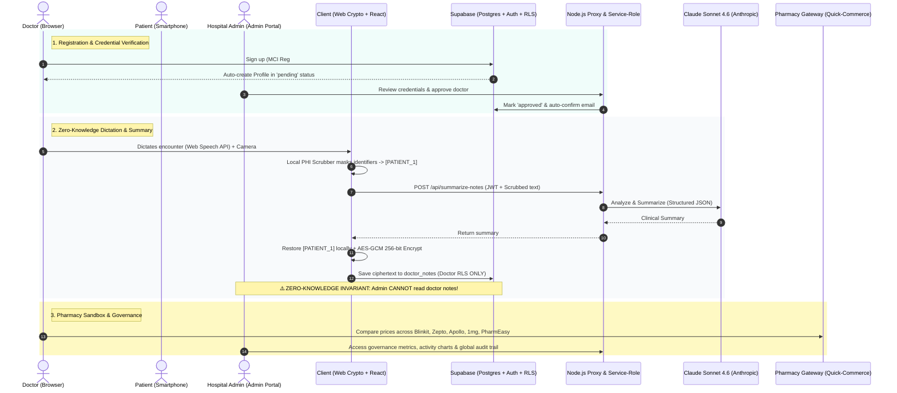

# ClinicNotes

> **Zero-Knowledge Multi-Tenant Hospital Documentation & Outpatient Telemedicine Suite**

[](https://nodejs.org/)
[](https://react.dev/)
[](https://vitejs.dev/)
[](https://tailwindcss.com/)
[](https://supabase.com/)
[](LICENSE)

---

## 1. About the App

**ClinicNotes** is an enterprise-grade, privacy-first clinical assistant engineered to eliminate clinical documentation burnout for doctors while guaranteeing zero-knowledge patient data privacy. 

Traditional clinical transcription tools send sensitive patient health records to third-party clouds in plaintext. ClinicNotes solves this by implementing **client-side Web Crypto AES-GCM 256-bit encryption** and a local **Protected Health Information (PHI) Scrubber**: patient encounters are scrubbed before reaching the AI proxy, and the final notes are encrypted in the doctor's browser before being saved to the database. Even hospital database administrators cannot read note contents.

### Key Capabilities

- **Doctor Dictation & Smart Categorization:** Real-time Web Speech transcription with automated clinical entity tagging:
  - 🟢 **Medical History:** Soft green highlight
  - 🟡 **Medications Prescribed:** Soft yellow highlight
  - 🔵 **Tests & Treatments:** Soft blue highlight
  - 🔴 **Protected Health Information (PHI):** Highlight-free red font color
- **Client-Side Zero-Knowledge Encryption:** Encrypted in the browser using the doctor's passphrase via AES-GCM 256-bit. Database stores only ciphertext and IV.
- **Doctor-Patient Consultation & Diarization:** Real-time dual-speaker dialogue capture, keyboard shortcuts (`Space`), and a **Two-Device Mobile Station** (patients scan a QR code to turn their phone into a mic).
- **Pharmacy Quick-Commerce Gateway:** Price, stock, and ETA comparison across Indian quick-commerce and e-pharmacy platforms (Blinkit, Zepto, Apollo, Tata 1mg, PharmEasy) with mandatory prescription verification.
- **Multi-Tenant Hospital Governance:** Role-separated Doctor and Admin portals, cascading State → Hospital → Branch signup, credential verification, and tamper-evident audit logs.

---

## 2. System Architecture



---

## 3. Tech Stack

| Layer | Technology | Purpose |
|:---|:---|:---|
| **Frontend** | React 18, Vite | High-performance SPA with instant HMR |
| **Styling** | Tailwind CSS | Clean, minimal, neutral hospital-grade theme (Teal accent, no dark mode) |
| **Icons & Charts** | Lucide React, Recharts | Clinical iconography and governance trend visualizers |
| **PDF Generation** | jsPDF | Client-side branded clinical discharge summary export |
| **Backend** | Node.js, Express, Socket.IO | Secure proxy, per-user rate limiters, WebSocket room syncing |
| **Validation** | Zod | Strict schema validation on all incoming admin/API payloads |
| **Database & Auth** | Supabase (PostgreSQL) | Managed multi-tenant Postgres, Auth with JWT, Row-Level Security (RLS) |
| **Cryptography** | Web Crypto API | Client-side AES-GCM 256-bit encryption with PBKDF2 key derivation |
| **Speech & AI** | Web Speech API, Claude 3.5 Sonnet / 4.6 | In-browser speech-to-text; structured clinical summaries via Anthropic |
| **Fuzzy Matching** | Fuse.js | Client-side and server-side medicine brand matching |
| **Testing** | Vitest | Comprehensive test suite for auth guards, PHI scrubbing, and schemas |

---

## 4. Current Limitations

Honest transparency regarding current third-party integrations and platform constraints:

1. **Quick-Commerce & E-Pharmacy APIs (Blinkit, Zepto, Apollo, Tata 1mg, PharmEasy):**
   - Indian quick-commerce and online pharmacy platforms **do not offer public developer APIs** or open third-party merchant sandboxes.
   - To demonstrate real-world utility without scraping or violating terms of service, ClinicNotes implements an **adapter-pattern simulated sandbox gateway** with real-world Indian medicine catalogs, dynamic discount algorithms, and simulated real-time SSE delivery tracking.
2. **Browser Web Speech API Dependencies:**
   - Speech-to-text relies on the browser's native `webkitSpeechRecognition` (Google Chrome or Microsoft Edge recommended).
   - Accents, specialized pharmaceutical brand names, or noisy OPD environments may require occasional manual doctor correction via the inline editable transcript.
   - Speaker diarization in consultation mode utilizes an active doctor/patient toggle and keyboard shortcuts rather than an expensive multi-channel server telephony model.
3. **Direct Hospital EHR (HL7 / FHIR) Integration:**
   - ClinicNotes currently persists notes to its own zero-knowledge encrypted database. It does not yet feature bidirectional certified HL7/FHIR connectors to synchronize directly with legacy enterprise EHR systems (e.g., Epic, Cerner).
4. **Regulatory Certification Scope:**
   - While architected to comply with technical privacy principles of HIPAA and the Indian Digital Personal Data Protection (DPDP) Act (client-side encryption, local PHI scrubbing, right-to-erasure audit logs), commercial hospital deployment requires a formal Business Associate Agreement (BAA) with hosting providers and an independent SOC-2 Type II audit.

---

## 5. Future Roadmap & Planned Upgrades

- [ ] **Official Pharmacy Partner API Connectors:** Formal commercial API integration with certified Indian pharmacy delivery networks for live prescription dispatch and checkout.
- [ ] **SMART on FHIR Connectors:** Bidirectional HL7 FHIR integration allowing direct export to existing hospital EHRs (Epic, Cerner, Allscripts).
- [ ] **Fine-Tuned Medical Audio Models:** Integration with self-hosted or dedicated medical acoustic models (Whisper Large-v3 / Deepgram Medical) supporting multi-language Indian accents (Hindi, Hinglish, Tamil, Telugu, Punjabi).
- [ ] **Enterprise Key Management System (KMS):** Optional organizational key escrow via AWS KMS or HashiCorp Vault for hospital-managed emergency recovery under strict compliance policies.
- [ ] **Native Mobile Application:** React Native / Flutter tablet application for mobile doctor rounds and OPD bedside dictation.
- [ ] **Offline Edge AI (Local LLMs):** WebGPU / Ollama on-premises inference to allow complete offline note summarization on local hospital intranet servers.

---

## 6. Getting Started

### Prerequisites
- **Node.js** (v18.0.0 or higher)
- **npm** (v9.0.0 or higher)
- A free **Supabase** account (optional for local demo mode)

### Installation & Setup

1. **Clone the repository:**
   ```bash
   git clone https://github.com/your-username/clinicnotes.git
   cd clinicnotes
   ```

2. **Install dependencies:**
   ```bash
   npm install
   ```

3. **Configure Environment Variables:**
   Copy the example environment file:
   ```bash
   cp .env.example .env
   ```
   Fill in your configuration:
   ```env
   PORT=5000
   NODE_ENV=development
   CLIENT_ORIGIN=http://localhost:5173

   # Optional: Anthropic API Key (if empty, runs in high-fidelity sandbox simulator)
   ANTHROPIC_API_KEY=

   # Supabase Configuration
   VITE_SUPABASE_URL=https://your-project.supabase.co
   VITE_SUPABASE_ANON_KEY=your-anon-key
   SUPABASE_URL=https://your-project.supabase.co
   SUPABASE_SERVICE_ROLE_KEY=your-service-role-key

   # Dev flag (disables email confirmation requirement for demoing)
   VITE_REQUIRE_EMAIL_CONFIRMATION=false
   ```

4. **Initialize Supabase Database:**
   - Open your Supabase Dashboard → **SQL Editor**.
   - Paste the contents of `supabase/schema.sql` and click **Run**.
   - Create your first admin account by running:
     ```sql
     SELECT public.promote_user_to_admin('admin@clinicnotes.hospital');
     ```

5. **Start Development Server:**
   ```bash
   npm run dev
   ```
   - **Frontend:** [http://localhost:5173](http://localhost:5173)
   - **Backend API:** [http://localhost:5000](http://localhost:5000)

---

## 7. Quality Assurance & Tests

Run the Vitest test suite covering auth gating, Zod validation, PHI scrubbing, and encryption invariants:

```bash
npm test
```

```text
✓ tests/phiScrubber.test.js (3 tests)
✓ tests/jsonParser.test.js (4 tests)
✓ tests/pharmacyMatcher.test.js (5 tests)
✓ tests/authAndAdmin.test.js (20 tests)

Test Files  4 passed (4)
     Tests  32 passed (32)
```

---

## 8. License

This project is licensed under the MIT License — see the [LICENSE](LICENSE) file for details.
